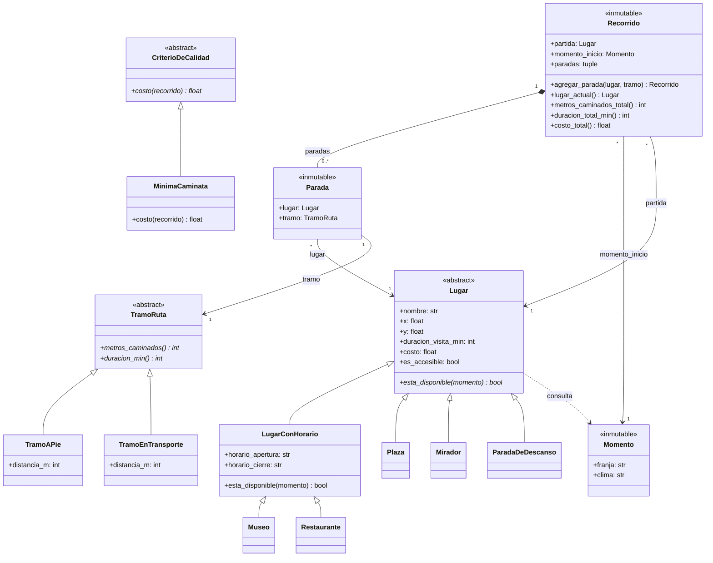

# Ruta viva — Diseño

## La variante

- **Visitante:** persona con movilidad reducida.
- **Regla propia:** transporte combinado (el recorrido puede alternar tramos a pie con
  tramos en un transporte accesible).
- **Criterio de calidad:** mínima caminata.

Las tres cuentan la misma historia: para esta persona la pregunta no es "¿cuántos
atractivos puedo ver?" sino "¿cuánto tengo que caminar para verlos?".

## Las clases

Además hay funciones puras fuera de las clases:

| Función | Qué hace |
|---|---|
| `planificar(partida, momento, tiempo_disponible_min, catalogo, criterio)` | Arma el `Recorrido` |
| `costo_de_ir(recorrido, lugar, criterio)` | Cuánto costaría el recorrido si el próximo fuera `lugar`, y la distancia para desempatar |
| `lugares_visitables(catalogo, momento)` | Deja los lugares accesibles y disponibles (perezosa) |
| `tramo_entre(origen, destino)` | Hasta 400 m, `TramoAPie`; más, `TramoEnTransporte` |
| `distancia(a, b)` | Distancia en línea recta, en metros |
| `mejor_recorrido(recorridos, criterio)` | El recorrido de menor costo según el criterio |

Todo el modelo está en `ruta_viva.py`; los tests, en `test_ruta_viva.py`.

## Decisiones de diseño

### Objetos

- **`Lugar` es la base de 5 subtipos.** Lo común vive en `Lugar` y cada diferencia vive en
  el `esta_disponible` de su subtipo. Un tipo de lugar nuevo es una clase nueva: el resto
  no cambia, y hay un test que lo comprueba definiendo un tipo dentro del propio test.
- **`LugarConHorario` junta lo que Museo y Restaurante tenían repetido.** Los dos abren y
  cierran en una franja; el horario y su validación se escriben una sola vez.
- **Abstracción con `ABC` y `@abstractmethod`.** `Lugar`, `TramoRuta` y `CriterioDeCalidad`
  no se pueden crear directamente, y cada subclase está obligada a definir sus métodos. Es
  la forma que enseña "POO Relaciones".
- **`ParadaDeDescanso` distingue esta variante.** No es un atractivo: es un banco o baño
  accesible, y solo tiene sentido para este visitante.
- **Herencia solo donde hay "es un tipo de".** Un museo *es un* lugar y un tramo a pie *es
  un* tramo. Por eso el Teatro Solís salió del catálogo: estaba cargado como `Museo`, y un
  teatro no lo es.
- **`Recorrido` compone `Parada`.** El recorrido crea cada parada en `agregar_parada`, quien
  lo usa nunca crea una a mano, y la parada no significa nada fuera de ese recorrido.
- **`Parada` se asocia con `Lugar` y con `TramoRuta`.** El lugar existe aunque nadie lo
  visite. El tramo lo crea `tramo_entre` y se lo pasan a la parada: como la parada no lo
  crea, no es composición, aunque el tramo solo se use ahí.
- **Inmutabilidad con `@dataclass(frozen=True)` y tuplas.** Todas las clases con datos
  llevan el decorador, también las subclases: si no, se les podría agregar un atributo
  nuevo. Con `frozen`, una lista igual aceptaría `append`, por eso las colecciones son
  tuplas. Así, calcular un recorrido no puede modificar a otro, que es una restricción de
  la letra.
- **Invariantes al construir.** `Lugar` rechaza duración o costo negativos,
  `LugarConHorario` rechaza horarios inexistentes o que cierren antes de abrir, `Momento`
  rechaza franjas o climas inexistentes y `planificar` rechaza tiempo negativo. Un objeto
  inválido no llega a existir.
- **`es_accesible` es un filtro duro, no parte del criterio.** Para esta variante,
  "inaccesible" no es "peor": es "no sirve". Ver `ETICA.md`.

### Funciones

- **Funciones puras donde se calcula.** `planificar`, `costo_de_ir`, `distancia`,
  `tramo_entre`, `lugares_visitables`, `mejor_recorrido` y los totales de `Recorrido` no
  modifican nada ni dependen de nada externo.
- **`planificar` es una función, no una clase.** Recibe todo lo que necesita y devuelve un
  `Recorrido`. Una clase `Planificador` con un solo método no agregaba nada.
- **Orden superior.** `min(disponibles, key=lambda lugar: costo_de_ir(...))`,
  `min(recorridos, key=criterio.costo)` y `filter(...)` reciben funciones como argumento.
- **Evaluación perezosa.** `lugares_visitables` devuelve un `filter`, que no evalúa ningún
  lugar hasta que se lo recorre (hay un test), y los totales usan expresiones generadoras.
  No se escribieron generadores con `yield` porque el algoritmo no los necesita.
- **Un `while` en `planificar`.** Va armando una estructura paso a paso, justo el caso en
  que el material del curso dice que no conviene el estilo funcional. En cada vuelta saca
  de `disponibles` el lugar que menos le suma al costo y, si entra en el tiempo que queda,
  lo agrega. Si no entra, sigue con los demás. Lo único que muta es esa lista local; cada
  parada produce un `Recorrido` nuevo.
- **Efectos separados del cálculo.** `Momento` se inyecta y nunca se lee el reloj. Las
  coordenadas son datos fijos. Pantalla y teclado viven solo en `armar_recorrido.py`,
  nunca en `ruta_viva.py`.

### El criterio

- **Qué significa "mejor" y quién lo decide.** Lo decide el `CriterioDeCalidad`, con una
  sola pregunta: `costo(recorrido)`. Con `MinimaCaminata`, el costo son los metros
  caminados. `planificar` usa esa misma medida para elegir cada paso, y `mejor_recorrido`
  para comparar recorridos ya calculados: no hay dos ideas distintas de "bueno".
- **Cómo se elige el próximo lugar.** Para cada lugar disponible, `costo_de_ir` arma el
  recorrido candidato con `agregar_parada` y le pregunta su costo al criterio. Gana el que
  menos cuesta; si empatan, el más cercano, así el resultado no depende del orden del
  catálogo.
- **Límites conocidos.** No busca el óptimo (la letra no lo pide): decide paso a paso.
  Como el transporte cuenta 0 m, prefiere ir lejos en transporte antes que caminar un poco,
  y el recorrido puede cruzar la ciudad (desde Plaza Independencia hace 7,1 km para caminar
  0 m). Es consecuencia de medir solo la caminata: si se quisieran recorridos más cortos,
  alcanza con otro criterio que mida otra cosa, sin tocar `planificar`. Al comparar, un
  recorrido sin paradas gana con 0 m.
- **Cambiar el criterio no toca el algoritmo.** Un criterio nuevo solo implementa `costo`
  y se le pasa a `planificar`. Hay un test con un criterio que minimiza la plata gastada.

### Datos

- **`armar_recorrido.py` convierte lat/lon a metros antes de crear los `Lugar`.** El núcleo
  solo ve `x`/`y` en metros y nunca lee la ubicación de la computadora. Las coordenadas son
  de OpenStreetMap; accesibilidad, horarios y precios son datos de ejemplo.

## Alternativas descartadas

- **Un atributo `metros_caminados` en `Lugar`:** la distancia depende del tramo entre dos
  lugares, no de un lugar.
- **`Visitante` como clase:** la variante es fija y sus parámetros entran como argumentos.
  Se puede revisar si lo justifica el cambio de requisito.
- **Armar varios recorridos con un generador y quedarse con el mejor:** funcionaba, pero
  complicaba de más algo que la letra no pide.
- **Elegir siempre el lugar más cercano:** daba recorridos cortos (1,1 km desde Plaza
  Independencia), pero no minimizaba la caminata: con A a 390 m y B a 800 m caminaba 390 m,
  cuando ir primero a B en transporte daba 0 m. Además, "más cercano" y "menos metros" eran
  dos ideas distintas de "bueno" en el mismo criterio. Se reemplazó en el cambio de
  requisito.
- **Menor esfuerzo (un minuto a pie pesa como tres en transporte):** caminaba menos, pero
  seguía yendo y volviendo (2,1 km) y era más difícil de explicar.
- **Clases planas sin `frozen`:** se probaron, pero dejaban sin inmutabilidad, que la letra
  evalúa.
- **Grafo de calles o API de mapas:** daría distancias reales, pero la letra no lo pide y
  solo se permite la librería estándar.
- **Una clase `Planificador`:** tenía un solo método, así que quedó como función.
- **Un paquete con un archivo por clase:** son unas 200 líneas; en un solo archivo es más
  fácil de recorrer y explicar.
- **Terminar cuando el lugar elegido no entra:** era lo que hacía antes, pero cortaba el
  recorrido aunque otro lugar sí entrara.

## Qué cambió respecto del diseño original

- `Lugar` sumó `x`/`y`, porque el planificador necesita calcular distancias.
- `CriterioDeCalidad` pasó de solo puntuar recorridos a elegir el próximo lugar y dar el
  costo de un recorrido.
- Los `Enum` se reemplazaron por constantes de texto.
- `Parada` pasó de componer `TramoRuta` a asociarse con él, y `Recorrido` ahora crea sus
  paradas, para cumplir la definición de composición del curso.
- Se sacó el generador de candidatos.
- `Planificador` pasó a ser la función `planificar`, y todo el modelo quedó en un archivo.
- Se agregó `LugarConHorario` entre `Lugar` y `Museo`/`Restaurante`, para validar el horario
  y no repetir código.
- `MinimaCaminata` pasó de elegir el lugar con menos metros a pie a elegir el más cercano,
  porque el anterior hacía recorridos que cruzaban la ciudad.
- La inmutabilidad y `ABC` se quitaron y se volvieron a poner: sacarlas fue un error,
  documentado en `BITACORA_IA.md`.
- `Recorrido` sumó `partida` y `lugar_actual()`, y `CriterioDeCalidad` quedó solo con
  `costo`. Ver la sección siguiente.

## Cambio de requisito (Hito 2)

El profesor pidió dos cambios de diseño.

**1. Que el criterio mida lo mismo que dice minimizar.** `MinimaCaminata` tenía dos ideas de
"bueno": `elegir_siguiente` iba al más cercano y `costo` contaba metros caminados, y
`planificar` nunca usaba `costo`. Por eso "mínima caminata" no minimizaba la caminata.

- Se sacó `elegir_siguiente`: el criterio tiene una sola pregunta, `costo(recorrido)`.
- Se agregó `costo_de_ir(recorrido, lugar, criterio)`, que arma el recorrido candidato con
  `agregar_parada` y devuelve `(costo, distancia)`.
- `planificar` elige con `min(disponibles, key=lambda lugar: costo_de_ir(recorrido, lugar,
  criterio))`.

**2. Que el `Recorrido` conozca su partida y que `planificar` la excluya.** El primer tramo
salía de un lugar que el `Recorrido` no guardaba, y la regla "la partida no se visita" estaba
en `armar_recorrido.py`.

- `Recorrido` tiene `partida` y `lugar_actual()`. `planificar` ya no lleva una variable
  `actual` aparte: se lo pregunta al recorrido.
- `planificar` descarta la partida del catálogo por su cuenta, y se sacó ese filtro de
  `armar_recorrido.py`.

**Tests.** Se agregaron el ejemplo del profesor (A a 390 m y B a 800 m dan [B, A] con 0 m),
la partida dentro del catálogo, el desempate que no depende del orden, un criterio nuevo que
solo implementa `costo`, y `Recorrido.lugar_actual`. Cambiaron dos tests, y en los dos el
recorrido ahora camina menos:

- el que usaba `elegir_siguiente` pasó a probar `costo`;
- el de A a 300 m, B a 900 m y C a 920 m pasó de [A, B, C] con 320 m a [B, A, C] con 0 m.

Las predicciones se anotaron antes de ejecutar y las cinco coincidieron (ver
`PREDICCIONES.md`).

### Dos preguntas para la defensa

- **La disponibilidad se calcula una sola vez, con el momento de salida.** Un museo abierto
  solo a la mañana sigue contando como disponible aunque se llegue de tarde. Se dejó así
  porque el modelo de tiempo son tres franjas (mañana, tarde, noche) y no un reloj: para
  saber en qué franja se llega a cada lugar habría que convertir los minutos del recorrido en
  horas, decidir a qué hora empieza y termina cada franja y recalcular la disponibilidad en
  cada paso. Es un cambio posible, pero agranda el modelo, y la letra no lo pide. Queda como
  límite conocido.
- **Por qué Museo, Restaurante y ParadaDeDescanso son clases separadas si hoy no agregan
  comportamiento.** Son tipos distintos del dominio y pasan el test de "es un tipo de". Cada
  uno es el lugar donde va a vivir su propia regla cuando aparezca: un restaurante que solo
  cuenta al mediodía, o una parada de descanso que el planificador inserta cuando se camina
  mucho. Con clases separadas, ese cambio toca una sola clase. La alternativa honesta es un
  atributo `tipo` en `LugarConHorario` y en `Plaza`: es menos código hoy, pero cada regla
  futura terminaría en un `if tipo == ...`, que es lo que el curso pide evitar con
  polimorfismo. Para `ParadaDeDescanso` se reconoce que hoy compite como cualquier otro
  lugar y no se inserta cuando hace falta descansar.
