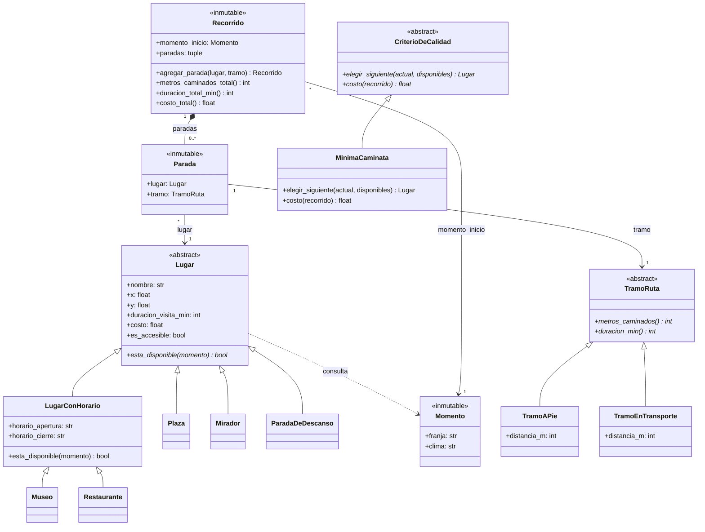

# Ruta viva — Diseño

## La variante

- **Visitante:** persona con movilidad reducida.
- **Regla propia:** transporte combinado (el recorrido puede alternar tramos a pie con
  tramos en un transporte accesible).
- **Criterio de calidad:** mínima caminata.

Las tres cuentan la misma historia: para esta persona la pregunta no es "¿cuántos
atractivos puedo ver?" sino "¿cuánto tengo que caminar para verlos?".

## Las clases

Además hay funciones puras fuera de las clases:

| Función | Qué hace |
|---|---|
| `planificar(partida, momento, tiempo_disponible_min, catalogo, criterio)` | Arma el `Recorrido` |
| `lugares_visitables(catalogo, momento)` | Deja los lugares accesibles y disponibles (perezosa) |
| `tramo_entre(origen, destino)` | Hasta 400 m, `TramoAPie`; más, `TramoEnTransporte` |
| `distancia(a, b)` | Distancia en línea recta, en metros |
| `mejor_recorrido(recorridos, criterio)` | El recorrido de menor costo según el criterio |

Todo el modelo está en `ruta_viva.py`; los tests, en `test_ruta_viva.py`.

## Decisiones de diseño

### Objetos

- **`Lugar` es la base de 5 subtipos.** Lo común vive en `Lugar` y cada diferencia vive en
  el `esta_disponible` de su subtipo. Un tipo de lugar nuevo es una clase nueva: el resto
  no cambia, y hay un test que lo comprueba definiendo un tipo dentro del propio test.
- **`LugarConHorario` junta lo que Museo y Restaurante tenían repetido.** Los dos abren y
  cierran en una franja; el horario y su validación se escriben una sola vez.
- **Abstracción con `ABC` y `@abstractmethod`.** `Lugar`, `TramoRuta` y `CriterioDeCalidad`
  no se pueden crear directamente, y cada subclase está obligada a definir sus métodos. Es
  la forma que enseña "POO Relaciones".
- **`ParadaDeDescanso` distingue esta variante.** No es un atractivo: es un banco o baño
  accesible, y solo tiene sentido para este visitante.
- **Herencia solo donde hay "es un tipo de".** Un museo *es un* lugar y un tramo a pie *es
  un* tramo. Por eso el Teatro Solís salió del catálogo: estaba cargado como `Museo`, y un
  teatro no lo es.
- **`Recorrido` compone `Parada`.** El recorrido crea cada parada en `agregar_parada`, quien
  lo usa nunca crea una a mano, y la parada no significa nada fuera de ese recorrido.
- **`Parada` se asocia con `Lugar` y con `TramoRuta`.** El lugar existe aunque nadie lo
  visite. El tramo lo crea `tramo_entre` y se lo pasan a la parada: como la parada no lo
  crea, no es composición, aunque el tramo solo se use ahí.
- **Inmutabilidad con `@dataclass(frozen=True)` y tuplas.** Todas las clases con datos
  llevan el decorador, también las subclases: si no, se les podría agregar un atributo
  nuevo. Con `frozen`, una lista igual aceptaría `append`, por eso las colecciones son
  tuplas. Así, calcular un recorrido no puede modificar a otro, que es una restricción de
  la letra.
- **Invariantes al construir.** `Lugar` rechaza duración o costo negativos,
  `LugarConHorario` rechaza horarios inexistentes o que cierren antes de abrir, `Momento`
  rechaza franjas o climas inexistentes y `planificar` rechaza tiempo negativo. Un objeto
  inválido no llega a existir.
- **`es_accesible` es un filtro duro, no parte del criterio.** Para esta variante,
  "inaccesible" no es "peor": es "no sirve". Ver `ETICA.md`.

### Funciones

- **Funciones puras donde se calcula.** `planificar`, `distancia`, `tramo_entre`,
  `lugares_visitables`, `mejor_recorrido` y los totales de `Recorrido` no modifican nada ni
  dependen de nada externo.
- **`planificar` es una función, no una clase.** Recibe todo lo que necesita y devuelve un
  `Recorrido`. Una clase `Planificador` con un solo método no agregaba nada.
- **Orden superior.** `min(disponibles, key=...)`, `min(recorridos, key=criterio.costo)` y
  `filter(...)` reciben funciones como argumento.
- **Evaluación perezosa.** `lugares_visitables` devuelve un `filter`, que no evalúa ningún
  lugar hasta que se lo recorre (hay un test), y los totales usan expresiones generadoras.
  No se escribieron generadores con `yield` porque el algoritmo no los necesita.
- **Un `while` en `planificar`.** Va armando una estructura paso a paso, justo el caso en
  que el material del curso dice que no conviene el estilo funcional. En cada vuelta saca
  de `disponibles` el lugar que eligió el criterio y, si entra en el tiempo que queda, lo
  agrega. Si no entra, sigue con los demás. Lo único que muta es esa lista local; cada
  parada produce un `Recorrido` nuevo.
- **Efectos separados del cálculo.** `Momento` se inyecta y nunca se lee el reloj. Las
  coordenadas son datos fijos. Pantalla y teclado viven solo en `armar_recorrido.py`,
  nunca en `ruta_viva.py`.

### El criterio

- **Qué significa "mejor" y quién lo decide.** Lo decide el `CriterioDeCalidad`, no
  `planificar`. Con `MinimaCaminata`, es mejor el recorrido con menos metros caminados.
  `mejor_recorrido(recorridos, criterio)` compara recorridos ya calculados.
- **Cómo elige `MinimaCaminata`.** En cada paso va al lugar más cercano. Si queda a 400 m o
  menos se camina; si no, se va en transporte. Así nunca se caminan más de 400 m seguidos y
  el recorrido no da vueltas por la ciudad.
- **Límites conocidos de este criterio.** No busca el óptimo (la letra no lo pide), así que
  no siempre da el mínimo total de metros: en un caso con lugares a 300, 900 y 920 m camina
  320 m, cuando ir primero en transporte daba 0 m. Y al comparar recorridos, uno sin paradas
  gana con 0 m.
- **Cambiar el criterio no toca el algoritmo.** Se agrega una subclase de
  `CriterioDeCalidad` y se le pasa a `planificar`.

### Datos

- **`armar_recorrido.py` convierte lat/lon a metros antes de crear los `Lugar`.** El núcleo
  solo ve `x`/`y` en metros y nunca lee la ubicación de la computadora. Las coordenadas son
  de OpenStreetMap; accesibilidad, horarios y precios son datos de ejemplo.

## Alternativas descartadas

- **Un atributo `metros_caminados` en `Lugar`:** la distancia depende del tramo entre dos
  lugares, no de un lugar.
- **`Visitante` como clase:** la variante es fija y sus parámetros entran como argumentos.
  Se puede revisar si lo justifica el cambio de requisito.
- **Armar varios recorridos con un generador y quedarse con el mejor:** funcionaba, pero
  complicaba de más algo que la letra no pide.
- **Elegir el lugar que obliga a caminar menos metros:** caminaba 0 m, pero como el
  transporte cuenta 0 m, cruzaba la ciudad para no caminar 150 m. Saliendo de Plaza
  Independencia recorría 7,1 km; yendo al más cercano son 1,1 km.
- **Menor esfuerzo (un minuto a pie pesa como tres en transporte):** caminaba menos, pero
  seguía yendo y volviendo (2,1 km) y era más difícil de explicar.
- **Clases planas sin `frozen`:** se probaron, pero dejaban sin inmutabilidad, que la letra
  evalúa.
- **Grafo de calles o API de mapas:** daría distancias reales, pero la letra no lo pide y
  solo se permite la librería estándar.
- **Una clase `Planificador`:** tenía un solo método, así que quedó como función.
- **Un paquete con un archivo por clase:** son unas 200 líneas; en un solo archivo es más
  fácil de recorrer y explicar.
- **Terminar cuando el lugar elegido no entra:** era lo que hacía antes, pero cortaba el
  recorrido aunque otro lugar sí entrara.

## Qué cambió respecto del diseño original

- `Lugar` sumó `x`/`y`, porque el planificador necesita calcular distancias.
- `CriterioDeCalidad` pasó de solo puntuar recorridos a elegir el próximo lugar y dar el
  costo de un recorrido.
- Los `Enum` se reemplazaron por constantes de texto.
- `Parada` pasó de componer `TramoRuta` a asociarse con él, y `Recorrido` ahora crea sus
  paradas, para cumplir la definición de composición del curso.
- Se sacó el generador de candidatos.
- `Planificador` pasó a ser la función `planificar`, y todo el modelo quedó en un archivo.
- Se agregó `LugarConHorario` entre `Lugar` y `Museo`/`Restaurante`, para validar el horario
  y no repetir código.
- `MinimaCaminata` pasó de elegir el lugar con menos metros a pie a elegir el más cercano,
  porque el anterior hacía recorridos que cruzaban la ciudad.
- La inmutabilidad y `ABC` se quitaron y se volvieron a poner: sacarlas fue un error,
  documentado en `BITACORA_IA.md`.
