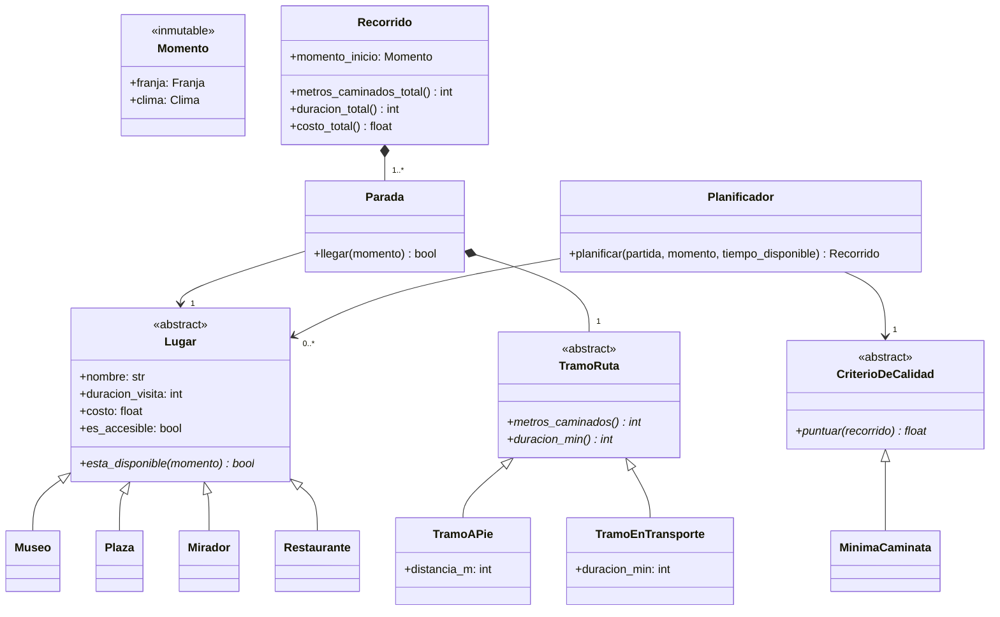

# Ruta viva — Diseño

## La variante

- **Visitante:** persona con movilidad reducida.
- **Regla propia:** transporte combinado (el recorrido puede alternar tramos a pie con
  tramos en un transporte accesible, no todo tiene que caminarse).
- **Criterio de calidad:** mínima caminata — entre varios recorridos posibles, gana el
  que exige menos metros caminados, no el que visita más lugares.

### Por qué esta combinación

Las tres partes cuentan la misma historia: para alguien con movilidad reducida, la
pregunta no es "¿cuántos atractivos puedo ver?" sino "¿cuánto tengo que caminar para
verlos, y hay alternativa cuando es demasiado?". Esto además le da contenido real y no
forzado a `ETICA.md`: el enunciado del proyecto ya sugiere como riesgo ético que el
recorrido tenga sesgo hacia "personas que no pueden caminar mucho" — acá esa pregunta
es el centro del diseño, no una nota al margen.

## Las clases

### Decisiones de diseño

- **`Lugar` es abstracta, con 4 subtipos concretos (polimorfismo).** Cada subtipo decide
  distinto cuándo está disponible (`esta_disponible(momento)`): un Mirador puede no
  valer la pena si llueve, un Museo tiene horario fijo. Agregar un tipo de lugar nuevo no
  toca el resto del programa (cumple la restricción del enunciado).
- **`Momento` es inmutable y se inyecta, nunca se lee del reloj del sistema.** Así el
  cálculo es reproducible: correr el mismo recorrido dos veces con el mismo `Momento` da
  el mismo resultado, y se puede probar un mediodía lluvioso sin esperar a que llueva.
- **`Parada` es asociación con `Lugar`, pero composición con `TramoRuta`.** El Lugar
  existe aunque nadie lo visite (un museo sigue ahí aunque hoy no entre en ningún
  recorrido) — asociación. El tramo para llegar a esa parada puntual no tiene sentido
  fuera de ella — composición, igual que la Serie dentro de la Rutina del práctico de UML.
- **`TramoRuta` es su propia jerarquía (a pie / en transporte), separada de `Lugar`.**
  Es la pieza central de la variante: un mismo recorrido puede alternar tramos a pie con
  tramos en transporte accesible. Si viviera dentro de `Lugar` no podría variar tramo a
  tramo.
- **`Recorrido` compone `Parada` (1..\*), no al revés.** Si se descarta un recorrido
  candidato, sus paradas desaparecen con él — no se comparten entre recorridos.
  `metros_caminados_total()` no se guarda como atributo: se calcula sumando los tramos
  cada vez, para que no pueda quedar un número viejo si cambia algo (inmutabilidad).
- **`CriterioDeCalidad` es una interfaz con una sola responsabilidad (patrón Estrategia),
  igual que las estrategias de boxes del práctico de F1.** Hoy hay una sola
  implementación (`MinimaCaminata`), pero el enunciado pide que cambiar el criterio no
  toque el algoritmo — así que vive separado de `Planificador` desde el día uno.
- **`es_accesible` en `Lugar` es un filtro duro, no parte del puntaje.** Un lugar no
  accesible se descarta antes de puntuar, no se penaliza y listo — porque para esta
  variante "inaccesible" no es "peor", es "no sirve". Esto después tiene que aparecer
  explicado en `ETICA.md`.

### Alternativas descartadas

- **Un solo atributo `metros_caminados` en `Lugar`** en vez de una jerarquía `TramoRuta`
  separada: se descartó porque la distancia depende del tramo entre dos lugares, no de
  un lugar en sí — un mismo Museo puede llegarse caminando o en transporte según el
  recorrido.
- **`Visitante` como clase propia:** se descartó por ahora — la variante es fija (siempre
  movilidad reducida), así que sus parámetros (tiempo disponible, si necesita transporte
  accesible) entran como argumentos de `Planificador` en vez de un objeto aparte. Se
  puede revisar si el cambio de requisito del Hito 2 lo justifica.
- **Guardar el puntaje dentro de `Recorrido`:** se descartó — puntuar es responsabilidad
  de `CriterioDeCalidad`, no del recorrido mismo (si no, agregar un criterio nuevo
  obligaría a tocar `Recorrido`).
